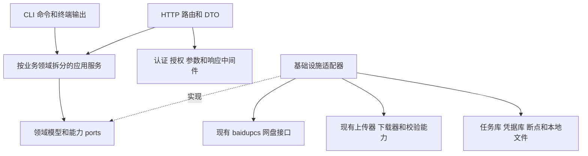
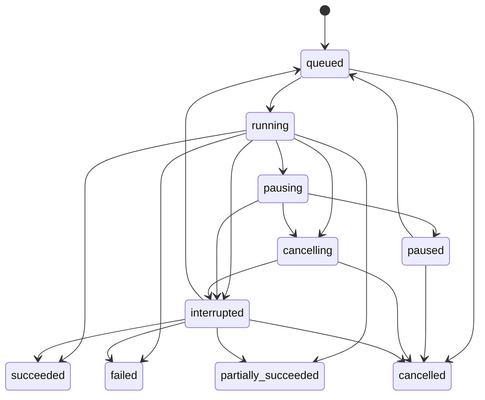

# BaiduPCS Go HTTP API 设计方案

日期：2026 年 11 月 5 日。状态：P0—P5已交付；74个操作implemented、0个partial、31个planned。P3账号、读取/扫描、持久事件、任务查询/逐项/重试及artifact验收见[P3记录](http-api-p3-verification.md)。P2传输、取消和重启恢复证据保留；P4完整传输及票据扩展见[P4记录](http-api-p4-verification.md)。

以主项目 `github.com/qjfoidnh/BaiduPCS-Go` 为唯一代码基线，在同一 Go module 内增加按业务领域拆分的 HTTP 服务。采用模块化单体：HTTP 负责协议转换，应用服务负责业务流程，底层适配器复用当前网盘和传输实现。CLI 与 HTTP 逐步共享业务服务。

本次基线是主项目远端 `main` 的 `1b9131817aaf8ca7dee24bc00e33ebc4c7a5cc73`，`versioninfo.json` 为 4.0.2，CLI 的 `Version` 为 `v4.0.2-dev`，`go.mod` 声明 Go 1.23。已创建分支 `codex/http-api-design`。参考项目快照为 `3d019e2`，仅提供实现参考，不作为依赖或合并基线。

配套文档：

- [P4/P5完成后的工程交接清单](http-api-handoff.md)
- [分阶段实施计划](http-api-implementation-plan.md)
- [源码接口和参数覆盖矩阵](http-api-coverage.md)
- [OpenAPI 3.1.1 契约与全部示例](../api/openapi/README.md)
- [P0 核对与行为基线报告](http-api-p0-baseline.md)
- [服务启动指南](http-api-server.md)、[P1实施验证](http-api-p1-verification.md)与[P2交付与验证](http-api-p2-verification.md)

## 1 覆盖范围和完成标准

完整性以当前代码中的业务能力为准，建立三个互相校验的清单：`main.go` 中的 34 个顶层命令及子命令，共 51 个命令节点、86 个命令参数；`baidupcs` 顶层包中的 132 个导出函数和方法；配置、上传下载和任务控制中的相关入口。命令别名归入原命令，不重复计算业务能力。全局日志参数另列。

每个入口必须归入以下一种处理方式，不能遗漏：

| 处理方式 | 含义 | 完成标准 |
| --- | --- | --- |
| HTTP 业务接口 | 账号、文件、传输等可以通过网络使用的业务能力 | 有契约、实现、错误映射和验收用例 |
| 内部适配 | `Prepare*`、客户端构造、Cookie 同步、分片握手、序列化等 | 有所属应用服务和适配器，不公开内部对象与原始令牌 |
| HTTP 等价表达 | 表格显示、当前目录、标准输出等 CLI 行为 | 用结构化字段、客户端上下文或结果文件表达，参数逐项映射 |
| 历史或实验能力 | 旧式秒传、未启用的超级转存、未生效参数 | 在覆盖矩阵和能力接口中说明真实状态，不伪报可用 |
| CLI 专属 | 交互终端、清屏、退出客户端、执行任意命令、自更新二进制 | 明确保留在 CLI，并提供适用的查询替代项 |

接口覆盖率、实现率、测试通过率和百度上游实测通过率分别统计。把导出方法归到内部适配不等于该业务已经实现；历史能力有明确处理结论也不等于可以成功调用。

现有 `docs/file_data_apis_list.md` 等文件描述百度上游接口，不作为本服务的 HTTP 契约。此方案也不承诺实现原项目没有实现的结构化数据 API。

### 1.1 实施取舍与契约成熟度

保留五层、配置快照、隔离客户端、Bearer、单实例 SQLite 和持久任务。先以 P2 的最小账号/实际上传下载/取消/重启恢复闭环验证边界，再补齐通用读取、事件和完整传输。不得等到 P4/P7 才第一次验证真实传输适配。

核心覆盖以主项目有效业务为准。context 会话、CLI 默认值管理、配置重载和诊断在 P6 实施，不作为核心账号/传输的前置。浏览器可续传接收、短期票据、QR 扩展等另列验收，不因列出路由就进入核心发布门槛。

公共身份、路径、错误、数值编码与已实现 P1 的语义保持稳定；planned 字段、状态和组件边界是可修订目标，依据最小链路的证据同步调整 OpenAPI、示例及本设计。operationId 保持稳定。覆盖数量不代表实现或验证率。P2已按[交接决策](http-api-handoff.md#3-p3-已固定的语义)同步planned/partial/implemented、能力、路由和校验；supported_option_values明确允许值，limits只表达数值资源上限。

五层只约束职责和依赖；按实际使用者定义小 port，不为简单操作建立五套转发对象。最小调度先满足持久化、有界队列、按任务取消和安全恢复，不提前建立通用工作流平台或复杂公平调度。

## 2 当前代码对设计的约束

| 源码事实 | 对设计的影响 |
| --- | --- |
| `main.init()` 改变进程工作目录、初始化旧配置，出错时可能退出 | 将副作用移到显式启动流程，server 模式不提前打开或改写旧 CLI 配置 |
| `pcsconfig.Config`、当前用户、用户工作目录是进程全局对象 | 请求明确绑定账号；相对路径只来自调用方自己的上下文 |
| `RunDownload`、`RunShareTransfer` 等主要打印结果，不返回完整结构化结果 | 从原流程抽出服务，CLI 保留格式化输出；HTTP 不抓取 stdout |
| `RunUpload` 注册信号并可能调用 `os.Exit` | 信号处理归进程入口，不能在每个 HTTP 任务中注册 |
| 传输 TaskUnit 内部仍读取全局限速、HTTP 客户端等配置 | 把配置和客户端注入执行单元；只新增工厂或 HTTP handler 不足以完成隔离 |
| `CopyPCS()` 复用客户端、签名状态和缓存引用 | 不能把它当作账号隔离或配置快照；由客户端工厂建立隔离实例 |
| 代理、代理域名规则、本地网卡地址等是 requester 全局变量 | 首先去除请求级全局修改；网络配置经过版本化工厂生效 |
| 上传数据库固定使用 `pcs_uploading.json`，主要按本地路径或摘要查找 | 服务断点按账号、目标路径和文件指纹隔离；并发任务不能各自打开同一旧文件 |
| `GracefulStopActiveUploaders` 影响全部上传器，停止标志持续置位 | 新任务控制按 job 隔离；全局停止仅用于服务关闭 |
| `TaskExecutor.Pause/Resume` 为空，下载器有 Pause/Resume/Cancel，上传器有 GracefulStop/Cancel | 按传输实现能力开放控制，不能仅调用空方法后返回成功 |
| `PrepareFilesDirectoriesList` 已支持分页，聚合列表方法按页取全 | HTTP 复用主项目当前解析和分页能力，不保留副项目旧版列表实现 |
| `NoSplitFile` 仅被传递和存储；`Rname` 的实际调用已注释 | 两个选项不能作为已可用功能宣传；非默认请求明确拒绝或待实现 |
| `RunFixMD5` 存在，但 `main.go` 没有注册 fixmd5 命令 | 覆盖底层修复能力，并标明它不是当前 CLI 命令 |
| `upload2.go` 主体处于块注释中，`SuperTransfer` 未接入当前转存流程 | 不把注释代码和未启用流程统计成已支持能力 |
| 错误文案和 CLI 帮助仍有 20GB 提示，实际 `MaxUploadSize` 为 128 × 2³⁰ 字节 | 能力接口分别返回代码限制和上游已验证限制，不把旧文案作为硬限制 |
| 强制指定用户名的后备逻辑可能使用固定 UID | 本地 `account_id` 独立于百度 UID，不以 UID 唯一标识全部账户 |

## 3 技术分层和依赖方向

### 3.1 五层职责

| 层 | 职责 | 允许依赖 | 约束 |
| --- | --- | --- | --- |
| 入口和组装 | `server` 子命令、配置加载、依赖组装、信号、关闭流程 | HTTP、应用服务、基础设施 | 只在此处组装对象和处理进程退出 |
| HTTP 接入 | 路由、认证、授权、参数解析、响应、SSE、文件流 | 应用服务、HTTP DTO | 不直接调用 pcsconfig 全局变量或拼百度请求 |
| 应用服务 | 校验、账号绑定、文件选择、业务编排、任务提交 | 领域模型、所需 ports | 不依赖 HTTP 框架或终端输出 |
| 领域模型和 ports | 账号、文件、传输选项、任务状态、错误；外部能力边界 | Go 基础类型和 context | 只抽象需要替换或隔离的边界，不为每个函数建立接口 |
| 基础设施适配 | 百度接口、现有传输器、持久化、凭据、本地文件、时钟 | 现有核心包、ports | 把上游数据和错误转换为服务模型 |



应用服务通过构造函数接收所需对象。HTTP handler 只执行“绑定 DTO → 调用服务 → 写响应”。CLI 命令只执行“解析参数 → 调用服务 → 打印结果”。业务流程只保留一份。

共享 port 的最小边界如下。每个 port 按使用者需要拆分，不能为了复用让所有业务依赖一个包含全部百度方法的大接口。

| Port | 责任 | 主要使用者 |
| --- | --- | --- |
| AccountRepository 和 CredentialStore | 账号元数据、凭据版本、秘密引用和吊销 | 账号、登录、ClientFactory |
| ClientFactory | 根据明确账号、网络配置和凭据版本构建隔离客户端 | 百度和传输适配器 |
| FileReader 和 FileWriter | 文件元信息、分页、遍历、明确的写操作结果 | 文件、传输、导出 |
| UploadEngine 和 DownloadEngine | 使用有效选项执行，提供进度观察者和按任务控制句柄 | 上传、下载 |
| ShareGateway、TransferGateway、OfflineGateway、RecycleGateway | 各自领域的结构化百度操作 | 对应应用服务 |
| JobRepository 和 JobScheduler | 原子状态变更、持久化队列、事件和资源预算 | 全部长操作 |
| CheckpointStore | 账号、目标、文件指纹绑定的传输断点 | 上传、下载和恢复 |
| ConfigurationRepository | 校验后的配置版本、默认值与生效状态 | 组装、配置、任务提交 |
| LocalFileStore 和 ArtifactStore | 受限根目录、暂存接收、引用生命周期和结果文件 | 传输、导出和本地工具 |

### 3.2 建议目录

以下为目标目录；P1已创建bootstrap、httpapi、application、domain/ports及infrastructure运行基础，对应责任与测试见P1记录。账号和单文件传输的受限P2生产HTTP已经存在；文件及其余业务目录按后续用例补齐，不重复创建已有实现。

```text
main.go                                # 保留 CLI，增加 server 子命令
internal/bootstrap/                    # 组装服务、资源和生命周期
internal/httpapi/
  server.go router.go
  middleware/                          # 身份、授权、日志、请求限制、恢复
  response/                            # Problem Details、分页、任务响应
  accounts/ contexts/ files/
  uploads/ downloads/ shares/ transfers/
  offline/ recycle/ integrity/ exports/
  jobs/ configuration/ system/ local/   # 各领域 handler、request、response、routes
internal/application/
  accounts/ contexts/ files/
  uploads/ downloads/ shares/ transfers/
  offline/ recycle/ integrity/ exports/
  jobs/ configuration/ system/ local/
internal/domain/
  account/ file/ transfer/ job/ configuration/ errors/
internal/ports/                        # 被多个应用服务共享的必要边界
internal/infrastructure/
  baidu/                               # 文件、分享、转存等百度适配器
  transfer/                            # 上传下载执行、观察者、按任务控制
  persistence/                         # 任务、事件、配置和幂等记录
  credentials/                         # 凭据和短期登录秘密
  localfs/                             # 允许访问的本地根目录、临时文件、结果文件
  legacyconfig/                        # CLI 配置和旧断点兼容
internal/pcscommand/                   # 逐步变成应用服务的 CLI 适配
baidupcs/ requester/                    # 保留主项目核心，按需要做小范围兼容扩展
api/openapi/                           # P0 起维护的契约和示例
docs/http-api-*.md                      # 设计、覆盖和实施资料
```

不拆多个 Go module，也不复制主项目核心到独立 API 仓库。保留现有 module 路径，以便合法使用 `internal` 包并持续跟进上游。后续若要独立 SDK，SDK 仅依赖公开 HTTP 契约。

### 3.3 HTTP 技术选择

建议使用标准库 `net/http` 作为接入层，保持主项目 Go 1.23 基线；初期不因参考项目使用 Gin 而批量引入其依赖。路由、SSE 和流式下载均以 HTTP 标准接口实现，业务服务不绑定路由器。

契约固定为 OpenAPI 3.1.1，唯一源为 `api/openapi/openapi.yaml`；P0 已实际验证 openapi-spec-validator 0.7.2、jsonschema 4.23.0、PyYAML 6.0.2 对该契约及示例的支持。P0 不引入 Go DTO/服务代码生成器。HTTP DTO、校验和接口文档以同一份契约验收。[OpenAPI 规范](https://spec.openapis.org/oas/v3.1.1.html)

存储默认采用单实例 SQLite，保存任务、事件、账号索引、配置版本和幂等记录；文件内容和大结果保存到专用数据目录。P0 隔离探测固定候选 `modernc.org/sqlite v1.38.2`，Go 1.23.12、CGO=0 下五个初始服务目标可编译，本机事务和重开通过；P1已引入生产依赖并完成13个原CLI目标的CGO=0构建验证。初始 server 目标为 darwin/arm64、darwin/amd64、linux/amd64、linux/arm64、windows/amd64；CLI 原目标范围保留，P1 必须按构建条件隔离服务存储依赖。服务实例获得数据目录独占锁，不支持多个实例同时调度同一任务库。

## 4 业务领域拆分

| 领域 | 所有权和边界 | 当前能力来源 |
| --- | --- | --- |
| 账号和登录 | 本地账号身份、凭据版本、登录会话、配额、账号可用能力 | pcsconfig、Baidu Login、UK、QuotaInfo、SpaceLeftInfo |
| 调用方上下文 | 调用方自己的账号选择和网盘工作目录 | 对 su、cd、pwd、who 的 HTTP 等价表达 |
| 文件 | 列表、元数据、搜索、树和递归扫描、匹配、增量、复制移动删除 | file_directory、rm_mkdir、cp_mv_rename、extends |
| 上传 | 本地或暂存文件上传、策略、预创建、分片、合并、上传断点 | pcsupload、uploader、baidupcs/upload |
| 下载 | 下载到服务器、三种下载模式、直链、代理内容、下载断点 | pcsdownload、downloader、baidupcs/download |
| 分享 | 创建、查询、详情、提取码和取消 | baidupcs/share |
| 分享转存 | 解析分享文本、验证提取码、选择 fs_id、归档、转存后下载 | pcscommand/transfer、baidupcs/transfer |
| 离线下载 | 百度服务器离线任务及其状态 | CloudDl 系列；不与服务本地 job 混用 |
| 回收站 | 列表、恢复、永久删除和清空 | Recycle 系列 |
| 校验和兼容能力 | 本地摘要、下载校验、远端摘要信息、MD5 修复、历史秒传状态 | checksum、pcsdownload/utils、extends |
| 导出 | 递归导出、路径改写、旧格式和结构化结果文件 | pcscommand/export、ExportByFileInfo |
| 服务任务 | 排队、调度、分项结果、事件、暂停取消重试和恢复 | 新 job 层，复用现有传输执行组件 |
| 配置 | 类型化配置、默认值、版本、运行时生效、CLI 兼容 | PCSConfig 全部字段及其 setter |
| 本地文件和结果 | 允许访问的根目录、暂存文件、接收断点、结果文件和加解密 | pcsutil、crypto；作为传输和工具的支撑 |
| 系统和诊断 | 版本、能力、健康、网络、PCS 节点和指标 | env、getip、PreparePCSServers、运行状态 |

领域之间经应用服务或明确的 port 协作。分享转存后下载创建子 job；导出和文件扫描复用文件查询服务；上传下载只通过 job 服务提交和调度。禁止领域之间互调 handler。

## 5 统一 HTTP 契约

### 5.1 地址和身份

公开业务前缀为 `/api/v1`。目录中的 `A` 表示 `/api/v1/accounts/{account_id}`，`B` 表示 `/api/v1`，实现和 OpenAPI 中必须展开，不把这两个缩写写入实际 URL。

`account_id`、`job_id`、上下文和结果文件 ID 是服务生成的不透明字符串。百度 `uid`、`fs_id`、`share_id`、离线任务 ID 也用十进制字符串传输，以避免调用方整数精度问题。大小、字节进度、速率、累计条目数量和 revision 使用十进制整数字符串；页码、重试次数、并发数和分享天数等有上界的小整数使用 JSON number。时间使用带 UTC 时区的 RFC 3339 字符串。

所有账号业务使用路径里的 `account_id`。普通请求不读取进程“当前账号”。P2/P3首先使用显式账号与绝对路径或 base_path；P6调用方可选创建 context 保存浏览状态；相对路径必须额外提供自己的 `context_id` 或显式 `base_path`，两者不能同时给出。缺省路径为 `/`。context 账号和路径账号不一致时返回 409，不自动切换账号。

网盘路径使用 `/`；服务端本地路径使用 `root_id + relative_path`。文件名默认按字面量解释；通配符使用显式 selector 或路径匹配接口。任务在提交时固定匹配结果和根路径，排队后不重新解释调用方 cwd。

### 5.2 响应和错误

成功查询返回 200，创建资源返回 201，任务提交和控制请求返回 202，无响应体的成功删除返回 204。成功 JSON 使用 `{data, meta}`；`meta` 包含 `request_id`，分页时增加分页信息。列表为空时返回 `[]`。OpenAPI 文档、HTML、指标、SSE、图片和文件内容原样返回，不包 JSON 信封；HEAD 包括错误响应在内均无 body，错误业务码通过 `X-Error-Code` 返回。

错误使用 `application/problem+json`，遵循 RFC 9457，增加稳定的业务 `code`、`request_id`、`retryable` 和脱敏的上游信息。HTTP 状态码表达请求结果，不统一包装成 HTTP 200。[Problem Details 标准](https://www.rfc-editor.org/rfc/rfc9457.html)

```json
{
  "type": "urn:baidupcs:error:credential-expired",
  "title": "百度账号凭据已失效",
  "status": 422,
  "detail": "请更新此账号的登录凭据",
  "code": "BAIDU_CREDENTIAL_EXPIRED",
  "request_id": "req_example",
  "retryable": false,
  "upstream": {"provider": "baidu", "operation": "list", "code": "-6"}
}
```

| HTTP 状态 | 使用场景 |
| --- | --- |
| 400 | JSON、类型、必填参数或字段格式不正确 |
| 401 | 服务 API 身份缺失或无效；不用于表达百度账号失效 |
| 403 | 服务身份没有对应账号、路径或操作权限 |
| 404 | 服务资源或确定不存在的网盘路径 |
| 409 | 任务状态冲突、目标冲突、账号占用、幂等 key 对应不同请求 |
| 410 | 登录会话、暂存资源或事件回放游标已过期 |
| 412 | If-Match 配置或资源版本不匹配 |
| 413 | 请求体、文件接收或批量条目超过服务限制 |
| 415 | 请求 Content-Type 不支持 |
| 416 | 不满足的内容 Range 请求 |
| 422 | 业务参数不支持、百度凭据失效、所选控制能力不支持 |
| 428 | 需要强 If-Match 的更新操作未提供此头 |
| 429 | 调用方限流或队列配额不足，返回 Retry-After |
| 501 | 本地尚未实现且已经在契约中声明的可选能力 |
| 502 | 百度响应或协议无法解析，或未分类的上游业务错误 |
| 503 | 上游能力暂不可用、上游限流、维护或服务正在排空 |
| 504 | 同步上游请求超时 |
| 500 | 服务自身的未预期错误 |

按 `pcserror.Error` 的操作、错误类别和具体远端错误码做适配；错误码的含义必须结合调用接口解释，不能全局仅按一个整数判断。百度凭据失效后，相关 job 进入失败或等待人工处理的 interrupted 状态；服务 API token 保持其自身语义。

批量查询返回逐项 `items`、`summary` 和 `complete`。批量写操作统一进入 job，逐项记录结果。网盘批量操作不承诺事务回滚，不能因为部分成功而返回“全部成功”。

### 5.3 分页和大规模遍历

目录列表使用 `page`、`page_size`，每页最多 1000，排序使用 `order_by=name|time|size` 与 `direction=asc|desc`；并列项用稳定 ID 辅助处理。`total` 允许为 null；`has_more` 允许为 null，表示需要继续探测。不要为获得总数而在每次列表请求中拉全目录。

在 `baidupcs` 内增加最小的分页查询扩展，复用当前页解析器和 `PrepareFilesDirectoriesList`。保留现有聚合列表方法的行为，避免在 HTTP 层复制百度 JSON 解析。

分享和回收站保留上游页码语义；回收站每页 100，分享上游页容量无法确认时 `page_size=null`，不接受客户端自定页容量。若搜索上游不支持分页，则使用有容量和 TTL 上限的查询快照，由服务自己的 opaque cursor 分页；大查询改为扫描任务。分页结果说明 `consistency=upstream_live|snapshot`，动态目录跨页不承诺快照一致性。

无限深度 tree、递归清单、统计、校验和导出通过 job 执行。树深度按当前 CLI 的 0 起点语义映射；`-1` 表示不限深度，仍受节点数、运行时长和调用方配额约束，超限必须报告 `complete=false`。

### 5.4 幂等和超时

所有会创建任务、分享、账号或上传会话的 POST 支持 `Idempotency-Key`。key 按调用方、账号、方法和规范化路由隔离，保存请求摘要和首次响应；默认保留至少 24 小时，活动 job 的绑定至少保留到任务终结。同 key 不同请求返回 409；同 key 重放返回首次响应状态和原资源，摘要包含路径参数。幂等重放优先于重复控制的“返回当前状态”规则。修改操作的上游结果不明时不得盲目自动重试。

同步请求使用请求 context 和有限的上游超时。异步 job 从服务生命周期创建自己的 context，提交请求断开不取消已入库任务。流式内容和 SSE 使用独立的读写期限策略和空闲检测，不套用整个请求 60 秒结束的统一 WriteTimeout。关闭流程停止接收新任务，等待或保存执行中的检查点，再关闭存储；流和任务需要分别排空。[Go HTTP 服务生命周期](https://pkg.go.dev/net/http#Server)

## 6 HTTP 接口目录

当前目标目录共 105 个 operation、89 个 path，operationId 固定为表中 ID；方法、路径和阶段由 P0 校验器逐项核对。完整字段和限制以 [OpenAPI](../api/openapi/openapi.yaml) 为准。表中阶段表示完整操作的验收阶段；UPL01、DWN01、JOB02/04/06/08的最小路径已在P2以partial开放；完整验收仍在原阶段。阶段编号对应调整后的实施计划。`条件` 表示必须通过能力检查；`扩展` 表示当前主项目没有现成的完整服务流程。表中列出完整目标契约。P4交付后51个操作implemented（含独立DWN05扩展）、0个partial；54个planned授权后501，逐项状态以OpenAPI中的x-capability为准。

### 6.1 系统和诊断

| ID | 方法和路径 | 输入及结果 | 阶段 |
| --- | --- | --- | --- |
| SYS01 | GET /healthz | 最小存活状态，不暴露账号和配置 | P1 |
| SYS02 | GET /readyz | 存储、配置和调度准备状态；不要求百度在线 | P1 |
| SYS03 | GET B/system | API 版本、程序版本、基线、启动时间、UTC 时间 | P1 |
| SYS04 | GET B/capabilities | 全部能力及实现、验证和启用状态 | P1 |
| SYS05 | GET B/diagnostics/network | 内网地址；可选主动检查出口 IP，不回显代理秘密 | P6 |
| SYS06 | GET A/diagnostics/pcs-servers | PCS 候选节点和有效时间；条件 | P6 |
| SYS07 | GET /metrics | 经授权的任务、错误、队列和传输指标 | P7 |
| SYS08 | GET B/openapi.json | 当前程序内嵌的版本化契约，受服务授权 | P1 |
| SYS09 | GET /docs | 基于同一契约的本地接口文档和调试页面，受服务授权 | P1 |

### 6.2 账号和登录

| ID | 方法和路径 | 输入及结果 | 阶段 |
| --- | --- | --- | --- |
| ACC01 | POST B/accounts | 导入 BDUSS 配合 PTOKEN/STOKEN/SBOXTKN/BAIDUID，或完整 Cookie，或 access token；返回脱敏账号 | P2 |
| ACC02 | GET B/accounts | 当前调用方可访问的账号清单 | P2 |
| ACC03 | GET A | 账号资料、登录状态、credential_revision、凭据存在标志 | P2 |
| ACC04 | PATCH A | 修改 label 等非秘密属性，If-Match | P3 |
| ACC05 | DELETE A | 删除本地账号及凭据；活动任务存在时 409；不声称注销百度全局登录 | P3 |
| ACC06 | PATCH A/credentials | 写入或清除指定凭据，更新版本；不返回原值 | P3 |
| ACC07 | POST A/validate | 检查账号状态和可获取的百度身份；不因失败删除凭据 | P2 |
| ACC08 | GET A/quota | total、used、free、采集时间 | P3 |
| ACC09 | GET A/capabilities | 此账号在当前凭据和配置下可使用的能力 | P3 |
| LOG01 | POST B/account-login-sessions | method=password 或 qrcode；创建短期登录会话 | P6 |
| LOG02 | GET B/account-login-sessions/{session_id} | waiting、challenge_required、confirmed、completed、expired、failed | P6 |
| LOG03 | GET B/account-login-sessions/{session_id}/qrcode | 经本服务授权返回二维码图片；仅 qrcode 会话 | P6 |
| LOG04 | POST B/account-login-sessions/{session_id}/responses | challenge_id 和验证码或短信/邮箱响应；仅支持已实现的 challenge | P6 |
| LOG05 | POST B/account-login-sessions/{session_id}/complete | 使用服务保存的交换状态建立或更新账号；统一 200 和账号 Location；不接受临时 BDUSS | P6 |
| LOG06 | DELETE B/account-login-sessions/{session_id} | 撤销会话并清理短期秘密 | P6 |

ACC01 的三类主凭据互斥，补充 Cookie 字段可随其兼容类型提交。Access token 账号不强求同时具备 BDUSS；无法查询的百度 UID 可以为空。token-only 账号只开放经过实现和验证的 token 能力。`force_login_username` 后备导入须显式标记 `identity_verified=false`。

Cookie 导入使用完整解析器，不能依赖必须有尾部分号的正则；格式错误或缺少 BDUSS 返回 400。只保存一个规范化 Cookie Jar，普通更新归档旧版本，已提交任务继续绑定旧版本；显式清除/删除撤销旧引用并停止相关连接，未知提交结果仍保留 interrupted。单字段修改和清除同步作用于 Jar；cookies=null 清除 Cookie 类凭据并保留独立 access_token，避免旧 Cookie 文本恢复已吊销字段。

密码、验证码、QR 临时令牌保存在短期秘密存储。手机和邮箱验证有完整的服务流程后才发布相应 challenge，不能调用会阻塞终端输入的 `RunLogin`。二维码登录流程可参考副项目，但会话绑定、过期清理和凭据输出按本方案实现。

### 6.3 调用方上下文

| ID | 方法和路径 | 输入及结果 | 阶段 |
| --- | --- | --- | --- |
| CTX01 | POST B/contexts | account_id、cwd；创建属于调用方的上下文 | P6 |
| CTX02 | GET B/contexts/{context_id} | 返回所选账号和 cwd，等价于 who、pwd | P6 |
| CTX03 | PATCH B/contexts/{context_id} | 切换账号或 cwd；校验目录；include_listing 可附列表；If-Match | P6 |
| CTX04 | DELETE B/contexts/{context_id} | 删除上下文，不影响已提交任务 | P6 |

切换账号默认重置 cwd 为 `/`；显式提供新 cwd 时校验它。context 有 TTL，且不能由另一个 API principal 读取或修改。修改 CLI 默认账号另走 CFG09，不影响此上下文。

### 6.4 文件领域

| ID | 方法和路径 | 输入及结果 | 阶段 |
| --- | --- | --- | --- |
| FIL01 | GET A/files | path、排序、页码、page_size、fields；目录列表 | P3 |
| FIL02 | GET A/files/metadata | path；完整元信息、目录标志、blocklist 和摘要可信状态 | P3 |
| FIL03 | POST A/files/metadata | paths；逐项批量元信息及失败明细 | P3 |
| FIL04 | GET A/files/search | path、keyword、recursive、fields；快照分页或有界结果 | P3 |
| FIL05 | POST A/file-scans | paths、options.mode=tree\|recursive\|statistics、options.depth、options.include_ids；返回扫描 job | P3 |
| FIL06 | POST A/path-matches | patterns、base_path 或 context_id；返回解析后的绝对路径 | P3 |
| FIL07 | POST A/directories | paths；创建目录 job，逐项返回实际结果 | P5 |
| FIL08 | POST A/file-deletions | selector、ignore_missing；删除至网盘回收站 job | P5 |
| FIL09 | POST A/file-copies | items[{from,to}]、目标冲突策略；复制 job | P5 |
| FIL10 | POST A/file-moves | items[{from,to}]、目标冲突策略；移动 job | P5 |
| FIL11 | POST A/file-renames | path、target_path；重命名 job | P5 |
| FIL12 | GET A/file-changes | cursor；上游增量结果、has_more、reset_required；条件 | P6 |

完整投影的 `FileEntry` 包含 `fs_id`、`app_id`、`path`、`name`、`is_dir`、`size_bytes`、创建和修改时间、`md5`、可选 `block_list`、`has_subdirectories`。`fields` 缺省为 all；投影仍始终返回 fs_id、path、name、is_dir、size_bytes、md5_status，app_id 未知时为 null。`md5_status=reported|possibly_inaccurate|verified|missing` 表达分片上传摘要的实际可信程度。

FIL07 至 FIL11 的 selector 在提交时固定。目标是目录还是重命名目的地由应用服务明确判断；多源目标不是目录时返回具体错误。需要上游不支持的覆盖策略时返回 422，不做静默降级。目录写入后按账号和相关路径失效缓存。

### 6.5 上传和文件接收

| ID | 方法和路径 | 输入及结果 | 阶段 |
| --- | --- | --- | --- |
| UPL01 | POST A/uploads | sources（local 使用 root_id+relative_path，staged 使用 staged_file_id）、target_dir、options；上传 job | P4 |
| UPL02 | POST B/staging-files | multipart 文件接收，返回 staged_file_id、大小和文件名 | P4 |
| UPL03 | GET B/staging-files/{file_id} | 调用方自己的暂存文件状态和过期时间 | P4 |
| UPL04 | DELETE B/staging-files/{file_id} | 删除未被任务占用的暂存文件；占用返回 409 | P4 |
| UPL05 | POST B/staging-upload-sessions | filename、size_bytes、可选 expected checksum；扩展，创建可续传接收会话 | P6 |
| UPL06 | GET B/staging-upload-sessions/{session_id} | 当前 offset、期望大小和过期时间 | P6 |
| UPL07 | PATCH B/staging-upload-sessions/{session_id}/content | 二进制数据和 Upload-Offset；原子前移 offset | P6 |
| UPL08 | POST B/staging-upload-sessions/{session_id}/complete | 校验接收长度和摘要，原子生成 staged_file_id | P6 |
| UPL09 | DELETE B/staging-upload-sessions/{session_id} | 清理未完成接收 | P6 |

客户端到本服务的接收断点与本服务到百度的上传断点是两种资源，分别管理。UPL02 使用随机文件 ID 和独立临时目录；原文件名只作元数据，不作为临时路径。完整落盘并取得任务引用后再返回接收成功。暂存文件在所有引用释放且达到保留期后删除。

上传保留文件及目录层级、空文件、同名策略 `skip|overwrite|rsync`、并发、最大重试次数、跳过秒传检测、文件名检查及限速。`rsync` 保持当前项目“按大小判断是否跳过”的语义，不宣称内容完全同步。

预创建、快速检查、分片上传和合并均归 UploadAdapter 内部管理。客户端不可传任意百度 uploadid 复用另一账号的会话。`no_split_file=true` 在实现并验证独立上传策略前返回 422；当前默认上传不因此受限。

### 6.6 下载和内容代理

| ID | 方法和路径 | 输入及结果 | 阶段 |
| --- | --- | --- | --- |
| DWN01 | POST A/downloads | selector、本地 root_id、目标目录和下载选项；返回下载 job | P4 |
| DWN02 | POST A/download-links | paths 或 fs_ids、source=pcs\|pan\|direct、https、link_index；逐项返回链接、link_ref 及所需 UA 信息 | P4 |
| DWN03 | GET A/content | path、Range、If-Range；经授权的文件代理内容 | P4 |
| DWN04 | HEAD A/content | 与 GET 一致的元信息和授权，无响应体 | P4 |
| DWN05 | POST A/download-tickets | path、有效期；扩展，生成仅用于该文件 DWN03/04 内容的短期 URL | P4 |

下载模式完整覆盖 `locate|pcs|stream`。保留覆盖策略、线程总预算、文件并发数、重试次数、测试下载、下载校验、修改时间、可执行权限、备选链接和完整路径选项。API 的 `test=true` 是实际测试传输但不写最终文件；计划预览使用独立 `dry_run`，不能混为一种行为。

`options.report_workers=true` 对应 CLI 的详细线程状态输出，结果进入 JOB03 和 JOB05。服务返回有效选项，说明 Windows 上不会生效的 executable 等平台差异。

`path_mode=relative` 的单文件使用 basename，单目录保留根名称；多根先去重并移除被已选目录覆盖的子项，再按所有选择根父目录的最近公共祖先保留相对路径。例如 /a/x 与 /b/x 分别保存为 a/x、b/x；`full` 保留网盘完整路径；如增加 `flat`，必须显式处理同名冲突。禁止使用副项目“统一保存目录加 basename”的简化逻辑。

代理使用服务内账号凭据，查询参数不接受 Cookie。仅向经过允许的百度和下载节点主机发送凭据，重定向逐跳检查，限制跳数，并绑定请求 context。同步代理不落完整文件到内存或本地。

代理处理 200、206、416、Range、Content-Range、Accept-Ranges、Content-Length、Content-Disposition；初版仅支持单个 byte range，多范围请求返回明确错误。HEAD 优先使用元数据或上游 HEAD，不能靠下载整个文件产生响应。流开始后发生的错误以终止流和事件记录表达，不能追加 JSON。

下载票据绑定账号、调用方、文件和有效期，不携带百度 Cookie；默认 60 秒、最大 300 秒。兑换 URL 指向 DWN03/04，短期 query `ticket` 可单独作为该文件的 Bearer 凭据；不要求同时提供长期 API token，但每次复核原调用方授权和绝对路径，不能授权其他接口。可允许有效期内的 Range 重取，避免一次性票据破坏浏览器续传。票据值不写访问日志。

### 6.7 服务任务

| ID | 方法和路径 | 输入及结果 | 阶段 |
| --- | --- | --- | --- |
| JOB01 | GET B/jobs | 调用方、账号、kind、state、时间过滤；游标分页 | P3 |
| JOB02 | GET B/jobs/{job_id} | 状态、进度、阶段、有效选项、可用操作和结果摘要 | P3 |
| JOB03 | GET B/jobs/{job_id}/items | 逐文件或逐项状态、错误和断点摘要；分页 | P3 |
| JOB04 | GET B/jobs/{job_id}/result | 最终结构化结果；未完成时 409 | P3 |
| JOB05 | GET B/jobs/{job_id}/events | SSE 和 Last-Event-ID，有限事件回放 | P3 |
| JOB06 | POST B/jobs/{job_id}/cancel | 按任务取消；等待已提交远端操作结束并保存已知状态 | P3 |
| JOB07 | POST B/jobs/{job_id}/pause | 按 kind 和阶段开放；上传在分片边界停止并保存断点 | P4 |
| JOB08 | POST B/jobs/{job_id}/resume | 从已确认检查点恢复；重验源文件和凭据版本 | P4 |
| JOB09 | POST B/jobs/{job_id}/retry | 创建新 job，默认只重试失败项；返回 retry_of_job_id | P3 |
| JOB10 | POST B/jobs/{job_id}/reconcile | 对中断且结果不明的远端操作做核对；支持能力按 kind 声明 | P5 |
| JOB11 | GET B/jobs/{job_id}/artifacts | 导出或扫描等任务的结果文件元数据 | P3 |

每个 job 包含 `job_id`、kind、owner、account_id、state、phase、created/started/finished_at、配置和凭据版本、父子任务关系、有效选项、total/processed/succeeded/failed/skipped/cancelled 数量、字节进度、速率、ETA 和具体错误。

未知总量返回 null，不能显示伪造的 0% 或 100%。文件上传被策略正常跳过记为 skipped，不能记为失败，也不能算作实际上传字节。测试下载的已传字节与落盘字节分别报告。

任务资源不包含密码、Cookie、签名令牌或加密密钥；这些仅保存秘密引用。清除或吊销凭据后，对旧引用停止执行并报告凭据已撤销；普通更新不改变已经提交任务的配置语义。

### 6.8 分享和分享转存

| ID | 方法和路径 | 输入及结果 | 阶段 |
| --- | --- | --- | --- |
| SHR01 | POST A/shares | paths、password、period_days、combined_link；返回分享及原始和带码链接 | P5 |
| SHR02 | GET A/shares | page；分享列表，可选补充提取码 | P5 |
| SHR03 | GET A/shares/{share_id} | ShareSURLInfo 可提供的详情、短链接和提取码 | P5 |
| SHR04 | POST A/share-cancellations | share_ids；取消分享 job | P5 |
| TRF01 | POST A/share-inspections | 首次 input 为分享 URL/整段文本及提取码；后续 inspection_id 支持目录展开和 cursor 分页 | P5 |
| TRF02 | POST A/share-transfers | share 输入或 inspection_id、target_dir、fs_ids、options.collect/download_after；返回转存 job | P5 |

分享提取码省略时可按主项目行为生成；显式非法值拒绝，响应给出实际使用的提取码。period_days 保留任意有效天数，0 为永久，不限于 1/7/30；上游不支持返回 422。ShareSURLInfo 只保证短链接和提取码，未知的列表字段省略；不把“合并链接输出”误解释为合并文件。

TRF02 支持主项目最新的整段分享文本解析、链接携带提取码、指定 fs_id 转存、归档目录和转存后下载。`options.download_after=true` 创建有依赖关系的下载子任务，必须提供 `options.download_destination`；远端文件可见性用有上限的退避检查，不照搬固定睡眠 10 秒。

旧秒传链接转存当前不可用。`options.randomize_name=true` 对应的旧 Rname 流程未启用，返回 422 并给出能力原因。`SuperTransfer` 作为未启用实验实现登记，不默认开放。

### 6.9 百度离线下载和回收站

| ID | 方法和路径 | 输入及结果 | 阶段 |
| --- | --- | --- | --- |
| OFF01 | POST A/offline-tasks | source_urls、save_path；统一返回 offline_add job，JOB04 逐项给出百度 offline_task_id | P5 |
| OFF02 | GET A/offline-tasks | 百度离线任务列表和结构化进度 | P5 |
| OFF03 | POST A/offline-tasks/query | offline_task_ids；最多 100 个唯一 ID，逐输入返回查询结果，禁止静默截断 | P5 |
| OFF04 | POST A/offline-tasks/cancellations | offline_task_ids；取消操作 job | P5 |
| OFF05 | POST A/offline-tasks/deletions | offline_task_ids；删除操作 job | P5 |
| OFF06 | POST A/offline-tasks/clear | 清空百度离线任务，统一返回 offline_clear job，结果含处理总数 | P5 |
| OFF07 | GET A/offline-tasks/{offline_task_id} | 单项查询，复用 QueryTask | P5 |
| REC01 | GET A/recycle | page；回收站列表 | P5 |
| REC02 | POST A/recycle/restorations | fs_ids；恢复 job，保存实际成功 ID 列表 | P5 |
| REC03 | POST A/recycle/deletions | fs_ids；永久删除 job | P5 |
| REC04 | POST A/recycle/clear | 清空回收站 job，返回成功数量 | P5 |

离线 source URL 按主项目支持的协议原样交给百度；本服务不代替百度抓取其内容。离线任务 ID 与服务 job ID 使用不同字段。已交付百度执行的任务，服务重启后通过百度状态重新查询，不能当作本地上传下载断点恢复。当前 CloudDlListTask 固定 start=0/limit=1000，服务 cursor 仅对实际收到的集合分页，不宣称获得全部历史任务。回收站保留 upstream_left_time 原值，源码未说明单位时不推算绝对过期时间。

### 6.10 校验和导出

| ID | 方法和路径 | 输入及结果 | 阶段 |
| --- | --- | --- | --- |
| INT01 | POST A/file-checksums/inspect | paths；获取远端长度、MD5、slice MD5、CRC32 等信息；条件 | P6 |
| INT02 | POST A/file-checksums/fix | paths；MD5 修复 job；条件 | P6 |
| INT03 | POST B/local/checksums | root_id、paths；计算本地长度、MD5、256 KiB slice MD5、CRC32 的 job | P6 |
| INT04 | POST A/file-verifications | 网盘路径和本地文件引用；校验 job | P6 |
| INT05 | POST A/file-checksums/from-link | 服务已签发的 link_ref 及可选比较摘要；条件，禁止任意 URL 代理 | P6 |
| INT06 | POST A/legacy/rapid-uploads | 旧式摘要秒传契约；默认报告上游能力不可用，不接受为成功任务 | P6 |
| EXP01 | POST A/exports | paths、options.recursive/root_path/format/max_retries；导出 job 和结果文件 | P6 |

远端摘要和 MD5 修复依赖上游返回的字段，不保证所有文件可成功处理。结构化导出、旧命令格式和旧通用链接格式分别标识。旧格式作为兼容数据输出，不声称可重新导入成功；任何生成的命令文件只作为下载内容，服务不执行其中命令。

EXP01 的默认输出是服务管理的 artifact，可另外指定允许的本地根目录。`stdout` 的等价表达是结果内容响应；不创建终端打印任务。导出每项包含成功、失败及缺失字段，保持可审计的部分结果。`options.root_path` 仅用于输出内容中的虚拟路径改写，省略或空字符串保留原路径，也允许相对值；不按 context/cwd 解析，不用于读取或写入本地目录。legacy_link 格式忽略根改写并报告 warning。

### 6.11 配置和本地支撑

| ID | 方法和路径 | 输入及结果 | 阶段 |
| --- | --- | --- | --- |
| CFG01 | GET B/configuration | 全部类型化客户端和传输配置、revision、脱敏状态 | P1 |
| CFG02 | PATCH B/configuration | 部分更新；If-Match；返回即时、新任务或重启生效字段 | P1 |
| CFG03 | GET B/configuration/schema | 字段类型、默认值、范围、单位和生效方式 | P1 |
| CFG04 | POST B/configuration/validate | 校验候选配置并返回规范化值，不保存 | P1 |
| CFG05 | POST B/configuration/reset | 重置指定客户端字段；不删除账号和任务 | P1 |
| CFG06 | POST B/configuration/reload | 从固定来源重载 22 个客户端字段，不导入账号凭据；dry_run 和 If-Match；启动字段变更需重启 | P6 |
| CFG07 | GET B/configuration/defaults | 当前代码的有效默认值和平台差异 | P1 |
| CFG08 | GET B/configuration/cli-defaults | CLI 默认账号及各账号默认工作目录的兼容映射 | P6 |
| CFG09 | PATCH B/configuration/cli-defaults | 更新 CLI 默认值；不修改 HTTP context 和运行 job | P6 |
| LOC01 | GET B/local/roots | 调用方可访问的 root_id、读写能力、可用空间状态 | P3 |
| LOC02 | POST B/local/encryptions | 本地文件引用、算法、秘密密钥、gzip 选项；兼容加密 job | P6 |
| LOC03 | POST B/local/decryptions | 同上；兼容解密 job | P6 |
| ART01 | GET B/artifacts/{artifact_id} | 结果文件元数据和过期时间 | P3 |
| ART02 | GET B/artifacts/{artifact_id}/content | 经授权下载结果文件，支持 Range | P3 |
| ART03 | HEAD B/artifacts/{artifact_id}/content | 内容元信息 | P3 |
| ART04 | DELETE B/artifacts/{artifact_id} | 删除不再使用的结果；保留任务中的结果摘要 | P3 |

全部 24 个 `PCSConfig` 导出字段都在覆盖矩阵中有归属。`BaiduUserList` 经账号 API 管理，凭据写入不通过普通配置接口；`BaiduActiveUID` 经 CLI 默认值接口管理。其余 22 个字段全部类型化暴露。`u_policy` 的 HTTP 名称统一为 `upload_policy`，导入旧配置时接受原字段。

PATCH 能区分缺失、false、0、空字符串和 null。false 是有效布尔值，速率 0 表示不限速，代理空字符串表示清除；不能用非零判断代替字段是否存在。应用层完成校验后再持久化，不能直接改全局字段后调用 Save 掩盖非法输入。

本地加解密保留主项目兼容算法和 gzip 行为，不把旧算法描述为新的安全存储方案。当前工具可能删除源文件，服务默认先在隔离工作目录操作副本；只有明确 `remove_source=true` 才允许在最终结果成功后删除源文件。密钥使用秘密引用，不进入任务参数和日志。

HTTP 加解密使用 `sources[{root_id,relative_path}]`、`destination`、`options` 和只写的 `key`；必须显式提供密钥，不继承 CLI 的默认密钥。服务没有保存可用于恢复的加密密钥时，相应任务在重启后不能自动恢复，须明确报告缺失秘密。

## 7 关键数据契约

### 7.1 上传任务请求

```json
{
  "sources": [{"type": "local", "root_id": "upload_root", "relative_path": "photos"}],
  "target_dir": "/备份",
  "options": {
    "file_concurrency": 2,
    "parallel_per_file": 4,
    "max_retries": 3,
    "policy": "skip",
    "skip_rapid_check": false,
    "check_filename": true
  }
}
```

对暂存内容使用 `{type:"staged",staged_file_id:"..."}`。响应为 202，`Location` 指向 JOB02，同时返回固定后的 sources、target 和有效选项。重试次数 0 表示不重试，不能被默认值覆盖。Job.effective_options 使用单独的 Effective* schema，必须完整返回适用的生效字段，不复用请求中可缺省字段的约束。

### 7.2 下载任务请求

```json
{
  "selector": {"kind": "paths", "values": ["/资料"]},
  "destination": {"root_id": "download_root", "directory": "archive"},
  "options": {
    "mode": "locate",
    "path_mode": "relative",
    "parallel": 4,
    "file_concurrency": 2,
    "max_retries": 3,
    "overwrite": false,
    "verify_checksum": true,
    "preserve_mtime": true,
    "executable": false,
    "link_index": 0,
    "test": false
  }
}
```

未提供的字段读取提交时配置；显式提供的 false、0 或 true 保留其意义。`parallel` 是当前主项目的下载总并发预算，应用服务按文件并发分配，不将总线程数和同时下载文件数混为一个配置。

### 7.3 任务响应

```json
{
  "data": {
    "job_id": "job_example",
    "kind": "download",
    "account_id": "acct_example",
    "state": "queued",
    "phase": "pending",
    "config_revision": "7",
    "credential_revision": "3",
    "progress": {"total_items": null, "processed_items": "0", "succeeded_items": "0", "failed_items": "0", "skipped_items": "0", "cancelled_items": "0", "total_bytes": null, "transferred_bytes": "0", "written_bytes": "0", "bytes_per_second": "0", "eta_seconds": null},
    "available_actions": ["cancel"],
    "links": {"self": "/api/v1/jobs/job_example", "events": "/api/v1/jobs/job_example/events"}
  },
  "meta": {"request_id": "req_example"}
}
```

以上任务响应为阅读节选，完整响应见 api/openapi/examples/http-exchanges.json。完整 DTO、oneOf 约束、必填字段、默认值、最大长度和响应示例已在 P0 写入 OpenAPI 并校验。所有目录条目、分项错误和任务选项都使用具体 schema，不用一个任意 map 代替完整领域契约。

## 8 任务调度和传输生命周期

### 8.1 状态和控制



终态为 succeeded、partially_succeeded、failed、cancelled。重试创建新任务并关联旧任务；恢复延续暂停或中断任务的已确认执行进度。状态变化使用数据库比较更新，重复控制请求返回当前状态。

状态为 cancelling 不表示远端效果已经撤销。运行中的复制、分享或转存请求可能已经成功；取消后要保留它们的已知结果。不能回滚的操作在任务结果中明确列出。pausing 遇到任务自然完成时可直接进入相应终态；cancelling 与完成竞争时，以实际已确认结果决定终态，而非强行伪报取消。

上传暂停以分片边界停止和保存检查点实现，恢复时重新建立执行器。下载使用底层下载器控制，但要补上传到 job 的控制句柄和事件。短时目录创建、删除、分享请求在已经提交远端之后不提供暂停；`available_actions` 随阶段变化。

### 8.2 并发和资源预算

P2先实现全局有界队列、活动任务上限和按任务取消，验证真实传输预算。P3/P4依据实际并发补齐账号限制、文件数、连接、带宽和暂存上限；调用方公平配额等管理策略后置。每个请求只提交到共享调度器，不能每次建立一个不受总预算限制的 executor。

按目标路径加操作锁：本地同一最终文件不能由两个任务并发写；远端同账号同目标的覆盖写串行执行。锁键使用规范化路径与账号，锁等待可取消。不同账号即使路径相同也不共享远端写锁。

下载先写任务管理的临时文件并保留断点，校验完成后按覆盖策略提交最终文件。保留主项目空文件、空目录、修改时间、权限和断点语义。上传恢复校验账号、目标路径、文件大小、mtime、摘要和分片状态；任一关键身份变化则废弃旧 uploadid 并说明原因。

### 8.3 事件和结果

SSE 事件类型为 `job.snapshot`、`job.created`、`job.state_changed`、`job.progress`、`item.completed`、`job.finished` 和心跳。无 Last-Event-ID 时先发送 job.snapshot，携带最新持久化事件 ID，再跟随之后的事件；心跳使用无 ID 注释。持久事件序号对单 job 单调递增，客户端可以收到重复事件；按事件 ID 去重。进度约每秒合并一次，终态事件立即持久化。

浏览器通过带 Authorization 的 fetch 流读取 SSE；不将长期 API token 放在订阅 URL 中。

保留事件的时间和容量由配置限制。Last-Event-ID 超过保留窗口返回 410，客户端重新查询任务快照后订阅；不能假装回放成功。慢客户端有有界缓冲，不阻塞任务执行。事件和结果始终检查调用方权限。

## 9 存储和迁移

| 实体 | 关键数据 |
| --- | --- |
| accounts | account_id、百度 UID、label、identity_verified、credential_ref、版本 |
| login_sessions | owner、method、state、challenge_ref、过期时间；秘密独立存储 |
| contexts | owner、account_id、cwd、版本、TTL |
| configuration_revisions | 规范化配置、版本、校验和、创建时间 |
| jobs | owner、account_id、kind、state、phase、配置/凭据引用、父子和重试关系 |
| job_items | 来源、目标、文件指纹、结果、已确认断点引用、逐项错误 |
| job_events | job_id、序号、事件种类、脱敏内容和时间 |
| idempotency_records | 作用域、key 摘要、请求摘要、资源引用和保留期 |
| staged_files 和 artifacts | owner、随机文件 ID、大小、状态、引用数和保留期 |
| credentials | 加密秘密及引用、版本、吊销状态；不把秘密放在 job JSON 中 |

任务提交时在一个事务中保存任务、幂等记录和初始事件，再返回 202。调度器从持久化 queued 状态获取任务，不能只依赖内存通知。恢复服务时，未完成任务先标 interrupted，核验检查点和上游结果后才能重新执行。

只对确认安全的传输断点或幂等读取自动恢复。分享创建、移动、转存等发生“上游已接收但本地未确认”的情况时，先核对结果；无法核对时保留不确定状态，禁止自动重放。此机制提供可恢复和可追踪执行，不宣称上游操作恰好执行一次。

服务使用独立的数据目录。旧 `pcs_config.json` 的导入和回写由单一适配器管理，有版本比较、文件锁、备份和原子替换。导入账号不能仅凭可能重复的百度 UID 合并，须结合凭据识别和显式映射。默认不让 CLI 和服务分别持有同一可写配置文件。

旧上传断点保留原文件，迁移时记录来源。旧记录缺少账号和目标绑定时，不直接用于另一个账号或不同目标：先核对或只复用安全的本地摘要，不盲目重用 uploadid。服务断点索引至少包含 account_id、目标网盘路径和源文件指纹。

凭据用专用 secret store 保存，master key 来自环境、操作系统密钥服务或权限受限的独立文件；配置中只保存引用。任务中的配置快照排除明文代理密码、Cookie 和密钥。备份需要同时考虑数据库、断点、暂存引用和密钥恢复。

## 10 配置生效和权限边界

客户端参数和传输默认值在任务提交时固定。新配置不改变正在运行任务的账号、目标或覆盖策略。限流预算可以按明确规则即时收紧；网络 Transport 配置创建新版本客户端，旧任务按其固定实例结束。P1 完成这层隔离前，存在活动请求时不允许热改 requester 全局网络变量。

监听地址、TLS、主密钥、存储位置等属于启动配置，需要重启，不在 v1 CFG02 的 22 个可写客户端字段内。CFG06 发现此类变更返回 422 STARTUP_CONFIGURATION_CHANGE_REQUIRES_RESTART，dry_run 不保存；当前客户端配置的 restart_required_fields 为空。配置重置只涉及所选客户端字段，保留账号、凭据、任务和服务鉴权。

服务 API 认证与百度账号登录分别管理。建议默认监听 `127.0.0.1`，使用随机的 Bearer API token；服务保存 token 摘要。通过静态 principal 配置账号 allowlist 和 `read`、`write`、`transfer`、`local.read`、`local.write`、`admin` 权限。初期单管理员即可，不建立与需求无关的用户注册系统。

| 接口类别 | 必需权限 |
| --- | --- |
| SYS01、SYS02 | 可匿名，只返回最小状态 |
| 系统版本、能力、契约和文档 | 已认证；网络诊断、metrics 需要 admin |
| 账号建立、删除、凭据更新、登录会话和配置更新 | admin；读取仍受账号 allowlist 约束 |
| 文件、分享、离线任务、回收站查询 | read 和账号访问权 |
| 文件写入、分享修改、转存、回收站写操作 | write；涉及持续传输时同时需要 transfer |
| 上传、服务器下载、内容代理和下载票据 | transfer 和账号访问权；读本地源另需 local.read，写本地目标另需 local.write |
| 任务查询、事件、控制和结果文件 | 任务 owner 或 admin，并保持原操作所需的账号和业务权限 |
| 本地摘要、加解密和根目录信息 | 对应 local.read/local.write，且 root 在授权清单中 |

context 的账号变更必须重新检查 allowlist。缓存、artifact、暂存文件和下载票据同样绑定 owner 与授权范围，不能仅凭随机 ID 访问。

本地 root 由管理员配置，调用方不能自行注册任意系统目录。解析 local path 后检查真实路径、软链接、父目录和写入位置；断开的软链接按主项目当前修复处理并报告，不造成崩溃。暂存目录与配置、凭据和可执行文件目录分开。

普通账号查询的凭据信息仅返回存在标志、版本和状态；账号 Sex/Age 等非秘密元数据可为空，保留原值，不猜测单位。日志按路由模板记录，不保存 Cookie、Authorization、密码、提取码、access token 和签名下载 URL。CORS 默认关闭，启用时使用精确 origin 白名单。反向代理头仅在已配置可信代理时使用。

## 11 运行能力和历史行为

每项 capability 包含 `id`、`implementation`、`availability`、`reason`、`required_credentials`、`supported_options`、`limits`、`verified_at`（可选 credential_alternatives 表达替代凭据组合）。实现状态与上游可用性分开：`planned|partial|implemented`；`available|unverified|upstream_unavailable|disabled`。`available` 必须有适用账号或上游验证依据，不能仅因为存在函数名就报告可用。

| 能力 | 当前源码状态 | 目标处理 |
| --- | --- | --- |
| 目录分页和上传断点续传 | 主项目已有实现 | 保留并做服务并发、恢复验收 |
| MD5 修复 | 核心函数存在，CLI 未注册 | INT02 条件开放，返回逐项结果 |
| 远端秒传信息和导出 | 代码存在，依赖上游头字段和旧格式 | INT01、INT05、EXP01；单独报告上游可用性 |
| 旧式摘要秒传和秒传链接转存 | CLI 已明确禁用相关转存路径 | INT06 默认不可用；不能承诺由 HTTP 恢复其上游功能 |
| Rname 随机改名 | 当前有效业务调用被注释 | 请求 true 返回明确不支持原因 |
| NoSplitFile | 声明和传递存在，实际分支未使用 | 先拒绝 true；后续独立实现后更新能力 |
| SuperTransfer | 有导出方法，当前调用未启用 | 记录为实验内部实现，不默认发布 |
| PCSUpload2 | 文件主体是块注释 | 不作为有效接口或现成实现 |
| 目录增量 | 有 Prepare 方法，没有完整服务结果模型 | FIL12 补适配、错误解析和上游实测 |
| QR 登录和 xpan 列表、元数据 | 副项目附加能力，主项目没有相同的完整 HTTP 流程 | QR 在 P6；xpan 作为可选扩展独立立项，不计入主项目必需覆盖率 |

如果加入 xpan，放入 `infrastructure/baidu/xpan` 和账号能力适配，统一复用文件 DTO、错误和凭据存储；不把副项目在 handler 中直接发请求的实现原样迁入。目标可选路由为 `GET A/xpan/files` 与 `POST A/xpan/files/metadata`，access token 来自账号秘密存储，不从 URL 接收。

## 12 参考项目复用和兼容原则

| 参考部分 | 处理 |
| --- | --- |
| 路由覆盖清单和 Swagger 注释 | 用于交叉核对遗漏，契约按本方案重新定义 |
| 文件、回收站、离线任务等直接调用 | 择优迁入对应应用服务和适配器，接当前主项目核心 |
| 扫码协议和 Cookie 捕获经验 | 在独立登录适配器中验证后复用 |
| 流式 Range 转发 | 借鉴字段处理，重做凭据、重定向、期限和取消 |
| 上传下载 handler 中复制的业务逻辑 | 用当前主项目服务化流程替代，不维护第二份执行逻辑 |
| 修改过的核心库、全局账号、默认弱密码和 Cookie 查询参数 | 不作为新服务基线 |

本轮尚无既有 API 调用方，默认直接发布 `/api/v1`，不承担副项目 `/api/ls` 等命令式路径的兼容义务。若后续明确需要兼容，则增加独立 legacy adapter，只做请求和响应翻译并调用同一业务服务；凭据暴露等行为不进入兼容承诺。

## 13 设计验收要求

设计进入编码前须满足：源码覆盖表无未归属业务入口；86 个命令参数、全局参数、配置字段和关键 options 均有处理结论；API、配置、任务和文件名词一致；所有条件能力标明实现及验证要求；阶段依赖和验收可执行。

实现验收包括：CLI 行为回归、契约一致、错误与部分成功、目录分页、跨账号并发、任务取消隔离、传输恢复、全局配置隔离、断点命名空间、Range、临时文件生命周期和服务重启恢复。具体门槛和测试安排见[分阶段实施计划](http-api-implementation-plan.md)。

## 14 源码和协议依据

- [固定版本主项目源码](https://github.com/qjfoidnh/BaiduPCS-Go/tree/1b9131817aaf8ca7dee24bc00e33ebc4c7a5cc73)
- [当前 CLI 入口](https://github.com/qjfoidnh/BaiduPCS-Go/blob/1b9131817aaf8ca7dee24bc00e33ebc4c7a5cc73/main.go)
- [当前目录分页](https://github.com/qjfoidnh/BaiduPCS-Go/blob/1b9131817aaf8ca7dee24bc00e33ebc4c7a5cc73/baidupcs/file_directory.go#L208)
- [上传执行和信号处理](https://github.com/qjfoidnh/BaiduPCS-Go/blob/1b9131817aaf8ca7dee24bc00e33ebc4c7a5cc73/internal/pcscommand/upload.go#L54)
- [上传断点存储](https://github.com/qjfoidnh/BaiduPCS-Go/blob/1b9131817aaf8ca7dee24bc00e33ebc4c7a5cc73/internal/pcsfunctions/pcsupload/upload_database.go#L35)
- [全局上传停止](https://github.com/qjfoidnh/BaiduPCS-Go/blob/1b9131817aaf8ca7dee24bc00e33ebc4c7a5cc73/internal/pcsfunctions/pcsupload/active.go#L18)
- [分享转存最新流程](https://github.com/qjfoidnh/BaiduPCS-Go/blob/1b9131817aaf8ca7dee24bc00e33ebc4c7a5cc73/internal/pcscommand/transfer.go#L15)
- [OpenAPI 3.1.1](https://spec.openapis.org/oas/v3.1.1.html)、[RFC 9457](https://www.rfc-editor.org/rfc/rfc9457.html)、[Go net/http](https://pkg.go.dev/net/http)


## 15 P3 落地补充

当前实现与限制以[P3指南](http-api-p3-guide.md)、[验收](http-api-p3-verification.md)为准。搜索和任务列表使用有界600秒快照；扫描逐项游标固定不可变条目的高水位，支持超过10000项的任务。任务查询、逐项结果、取消和retry覆盖当前三个已启用kind；retry固定scope并新建任务，不复用原传输检查点。扫描中断后取消再retry，JOB08继续只开放P2传输恢复子集。

SQLite从v3增量到v4；状态/检查点/逐项与持久事件同事务提交，事件序号独立于保留行。SSE最多64连接/128帧/15秒心跳，慢消费者断开后按持久游标重连。artifact使用受保护目录、流式写入、完成后24小时TTL、256MiB单文件/1GiB总配额，任务/读取引用保护物理清理。文件Range/HEAD沿统一协议，删除不移除任务摘要。

legacy_accounts_file在启动时显式选定，导入规范凭据和未验证显示名，不读取全局当前账号、不修改源配置；旧客户端字段及CLI默认值管理仍在P6。P3触及的CLI读取继续共享核心分页解析，保留聚合和输出，重复页及中途错误明确报告不完整。P2 checkpoint绑定/幂等ID保持兼容，回滚schema v4需要恢复一致备份。

P4实现补充：传输计划在入库前冻结至多10000单位，执行器分离准备、实例执行和逐项收集。CLI TaskUnit显式注入客户端、限速、调用控制，signal归main；旧下载worker cache按实例分配。JOB07排空后paused，JOB08新网络上下文核验原检查点。暂存使用v5加法表和任务事务引用；DWN03/04的Range与流独立期限，DWN05作为独立扩展。实现限制与上游范围见[P4指南](http-api-p4-guide.md)和[验收](http-api-p4-verification.md)。

## 16 P5 落地补充

P5全部23项沿原有任务和分层接入，当前契约0.5.0-p5、SQLite v6；范围与逐项证据见[P5指南](http-api-p5-guide.md)和[验收](http-api-p5-verification.md)。文件写入保存源/目标身份并明确处理fail/skip/overwrite；核心prepare错误不再丢失，覆盖不预先删除目标。文件ID选择在job准备中逐项解析，缺失ID保留部分成功和ignore_missing语义。

分享接受任意上游有效period，HTTP/CLI共用整段文本和提取码优先级解析；检查聚合所有根页并提供有界快照与目录展开，fs_id必须来自检查。真实分享页可能把ID编码为字符串，按整数直接解析避免float精度损失。collect建立任务独占目录，转存后核验可见性，按既有下载任务提供父子依赖。JobItem新增可选input/fs_id/offline_task_id/remote_effect，保留P3字段，完整逐项和item.completed都能读取实际写入结果。

离线source URL只提交百度，API不抓取；OFF03超过100拒绝，OFF02提供显式1000项上游窗口说明，不伪造全量或远端分页。回收站返回原始LeftTime字符串和实际恢复ID；授权范围内write接口可显式全局清空，真实验收不触发账号级破坏操作。

写入前持久化committing，未知保持interrupted。JOB10使用当前凭据，只读核验后落本地结果，不重发百度写请求；换凭据要求百度UK与原计划相同。证据不足保持未知。取消只影响本地执行意图，已提交百度事务不承诺回滚。SHR01同步创建使用单独加密意图/回执，避免响应丢失后用同Key重复分享。v6只增量添加两张业务表，旧任务/检查点/控制回执和暂存引用兼容；回滚必须恢复升级前一致备份。
